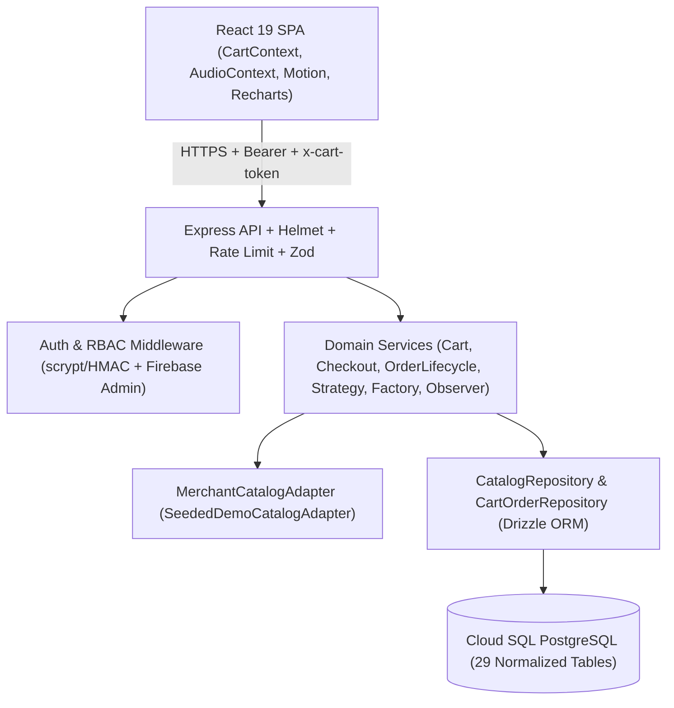
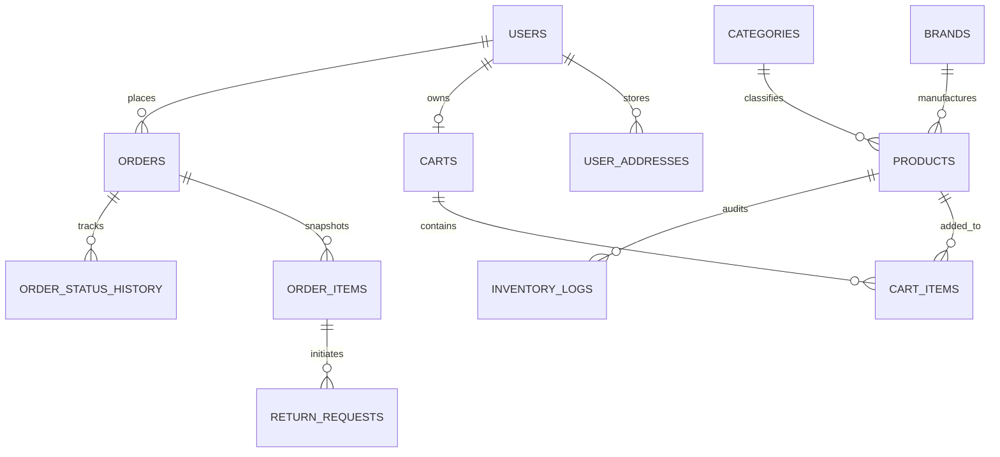
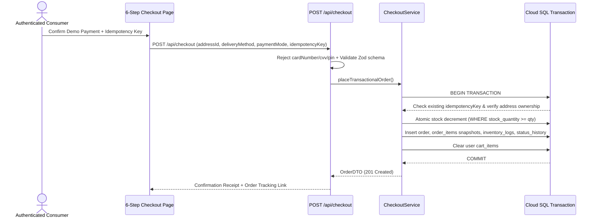

# CompareX Software Engineering Documentation (SDLC)

**Project:** CompareX — Smart Product Comparison, Discovery & E-Commerce Decision Support Platform  
**Tagline:** *Compare Smarter. Choose Better.*  
**Leadership:** Bogesh Manikanta (Founder), Nikhitha (Co-Founder), Jahnavi (Co-Founder)

---

## 1. Communication & Requirements Engineering

### 1.1 Problem Statement
Online consumers encounter fragmented product catalogs, inconsistent specification units across manufacturers, opaque hidden fees (delivery, installation, warranty, mandatory accessories), and disconnected comparison tools that force users to switch platforms before purchasing. CompareX unifies objective side-by-side comparison, deterministic recommendation intelligence, price-history transparency, and a full INR demonstration e-commerce lifecycle in a single full-stack platform.

### 1.2 Stakeholders
- **Guest Consumers:** Browse 31+ INR products across 17 categories and 26 real-world brands, compare 2–4 compatible models side-by-side, run explainable recommendations, explore interactive brand showcases, and build a persistent guest cart.
- **Registered Consumers:** Merge guest carts upon sign-in, manage shipping address books, execute 6-step demonstration checkout, track order lifecycle milestones, reorder past purchases, submit pre-shipment cancellations and post-delivery returns, and maintain wishlists and saved comparisons.
- **Administrators (`ADMIN` role):** Manage products, categories, dynamic specification schemas, brands, sellers, price observations, live stock levels and inventory logs, order fulfillment transitions, return/demo-refund queues, recommendation/delivery policy rules, CSV imports, user roles, and data quality audits.

### 1.3 Functional & Non-Functional Requirements
- **Functional:** Role-based access control (`GUEST`, `CONSUMER`, `ADMIN`); normalized EAV-style specification schema; unit-normalized 2–4 product comparison; Strategy-driven recommendation engine; DB-backed guest/user cart with automatic login merge; atomic transactional checkout with idempotency keys; order lifecycle state machine (`Order Placed` -> `Order Confirmed` -> `Processing` -> `Packed` -> `Shipped` -> `Out for Delivery` -> `Delivered` / `Cancelled`); post-delivery return & demo-refund workflow.
- **Non-Functional:** Parameterized Drizzle ORM PostgreSQL queries; `scrypt` password hashing + HMAC-SHA256 & Firebase ID token verification; server-side price/GST/delivery calculation; rate-limited authentication & checkout endpoints; WCAG AA contrast and `prefers-reduced-motion` support; responsive layouts.

---

## 2. Planning & Feasibility

### 2.1 Technology Stack
- **Frontend:** React 19, TypeScript, Tailwind CSS v4, Motion, Recharts, Lucide Icons, Web Audio API (`AudioContext` synthesis — zero external audio dependencies).
- **Backend:** Node.js, Express, TypeScript, Zod, Helmet, Express Rate Limit.
- **Database:** Cloud SQL (PostgreSQL) via Drizzle ORM (`drizzle-orm/node-postgres` + `pg` connection pooling).
- **Authentication:** Firebase Authentication (Google Sign-In) + server-side `scrypt` & HMAC-SHA256 bearer tokens.
- **Testing:** Vitest unit and full-stack integration suites.

### 2.2 Scope & Explicit Demonstration Boundaries
All product INR pricing, stock counts, seller offers, historical price points, payment modes (`DEMO_CARD_SIMULATION`, `DEMO_UPI_SIMULATION`, `DEMO_COD_SIMULATION`), delivery ETAs, and return refunds are **seeded demonstration simulations**. CompareX explicitly rejects real payment card PANs, CVVs, or UPI PINs on the server and performs zero unauthorized live retail scraping.

### 2.3 Risk Management
| Risk | Impact | Mitigation |
| :--- | :--- | :--- |
| Concurrent overselling during checkout | High | Atomic conditional stock decrement (`WHERE stock_quantity >= qty`) inside PostgreSQL `db.transaction` |
| Duplicate order submission on double-click / retry | High | Client-generated UUID `idempotencyKey` enforced via unique constraint on `orders.idempotency_key` |
| Client tampering with prices, taxes, or delivery fees | High | Server computes all line subtotals, category GST rates, and delivery charges from DB rows & `system_settings` |
| Real payment credential submission | Critical | Explicit payload rejection of `cardNumber`, `cvv`, `upiPin`, `pin` in `POST /api/checkout` |
| Missing/conflicting manufacturer specifications | Medium | Explicit `"Not available"` preservation (never coerced to zero) + automated Data Quality Audit |

---

## 3. Modeling, Architecture & Design Patterns

### 3.1 Layered Architecture & SOLID Principles
CompareX separates responsibilities across Presentation (`src/pages`, `src/components`, `src/context`), API Controllers (`server/routes/*.ts`), Domain Services & Patterns (`server/services/*.ts`, `shared/engines/*.ts`), External Integration Adapters (`server/adapters/*.ts`), Repositories (`server/repositories/*.ts`), and PostgreSQL (`src/db/schema.ts`):
- **Single Responsibility (SRP):** Checkout atomicity lives in `checkoutService.ts`; post-checkout status transitions, cancellation restocking, and returns live in `orderLifecycleService.ts`; cart computation lives in `cartService.ts`.
- **Open/Closed & Strategy Pattern (`server/services/recommendationService.ts`):** `RecommendationStrategy` encapsulates interchangeable scoring presets (`BALANCED_DECISION`, `BUDGET_VALUE`, `PERFORMANCE_FIRST`) configured dynamically by administrators in `system_settings`.
- **Factory Pattern (`server/services/specFactory.ts`):** `CategorySpecificationFactory` generates category-specific normalized specification records and default schema templates cleanly across Electronics, Fashion, Home Appliances, and Lifestyle categories.
- **Adapter Pattern (`server/adapters/merchantAdapter.ts`):** `MerchantCatalogAdapter` defines a uniform external catalog boundary with `SeededDemoCatalogAdapter` providing the active demonstration feed so future authorized merchant APIs can plug in without altering core comparison or cart logic.
- **Observer Pattern (`server/services/orderNotificationObserver.ts`):** `OrderEventBus` decouples order placement, status progression, cancellation, and return decisions from audit logging and simulated notification dispatch.

### 3.2 System Architecture Diagram

### 3.3 Core E-Commerce Entity Relationship Diagram

### 3.4 Sequence Diagram — Atomic Transactional Checkout

---

## 4. Construction & API Overview

### 4.1 Database Schema (29 PostgreSQL Tables)
- **Catalog & Specs:** `categories`, `subcategories`, `brands`, `products`, `product_images`, `specification_definitions`, `product_specifications`, `sellers`, `product_offers`, `price_observations`.
- **Auth & Workspace:** `roles`, `users`, `user_preferences`, `comparisons`, `comparison_items`, `wishlists`, `wishlist_items`, `recently_viewed`, `recommendation_requests`, `audit_logs`, `system_settings`.
- **Phase 3 E-Commerce:** `inventory_logs`, `user_addresses`, `carts`, `cart_items`, `orders`, `order_items`, `order_status_history`, `return_requests`.

### 4.2 Key API Endpoints
- **Catalog & Brands:** `GET /api/products`, `GET /api/products/:idOrSlug`, `GET /api/brands`, `GET /api/brands/:slug`, `POST /api/compare/analyze`, `POST /api/recommendations`, `GET /api/recommendation-config`.
- **Cart:** `GET /api/cart`, `POST /api/cart/items`, `PATCH /api/cart/items/:itemId`, `DELETE /api/cart/items/:itemId`, `POST /api/cart/merge`.
- **Checkout, Addresses, Orders & Returns:** `GET/POST /api/addresses`, `PATCH /api/addresses/:id/default`, `DELETE /api/addresses/:id`, `POST /api/checkout`, `GET /api/orders`, `GET /api/orders/:id`, `POST /api/orders/:id/cancel`, `POST /api/orders/:id/returns`, `POST /api/orders/:id/reorder`, `GET /api/returns`.
- **Admin Commerce Center (`/api/admin/*`):** `/inventory`, `/inventory/:productId/adjust`, `/orders`, `/orders/:id/status`, `/returns`, `/returns/:id`, `/recommendation-config`, alongside `/products`, `/categories`, `/brands`, `/sellers`, `/csv-import`, `/users`, `/data-quality`, `/audit-logs`.

---

## 5. Security Verification & Test Plan (`TC01–TC24`)
- **Security Controls:** Server-side RBAC (`requireAuth`, `requireAdmin`), cross-user ownership validation on saved comparisons, addresses, orders, and return requests, parameterized Drizzle ORM queries, strict URL sanitization (`sanitizeUrl`), explicit rejection of real payment card/CVV/PIN payloads, and rate limiting on auth & checkout routes.
- **Test Coverage (`tests/unit/engines.test.ts` & `tests/integration/api.test.ts`):**
  - `TC01–TC05`: Registration validation, login, invalid password rejection, guest 401 & consumer 403 admin blocks.
  - `TC06–TC08`: 31 INR products, 17 categories, 26 brands, `/api/brands/samsung` showcase, category/budget filtering.
  - `TC09–TC13`: 2–4 compatible product comparison, unit normalization, missing spec preservation, cross-category guard.
  - `TC14–TC15`: Explainable INR recommendations & Strategy weight recalculation.
  - `TC16–TC18, TC21`: Saved comparisons, cross-user 403 isolation, wishlist, price history observations.
  - `TC19–TC20`: Cart add, stock-limit enforcement, quantity update, guest cart merge on sign-in.
  - `TC22–TC24`: Address validation, real card rejection, atomic checkout + idempotency key deduplication, order cross-user 403, pre-shipment cancel stock restoration, post-shipment cancellation block, post-delivery return + demo refund restocking.

---

## 6. Deployment & Known Limitations
1. Configure Cloud SQL PostgreSQL credentials (`SQL_HOST`, `SQL_DB_NAME`, `SQL_USER`, `SQL_PASSWORD`, `SQL_ADMIN_USER`, `SQL_ADMIN_PASSWORD`) and push schema (`npx drizzle-kit push --config=src/db/drizzle.config.ts`).
2. Build with `npm run build` and launch via `npm run start` (`tsx server.ts`).
3. **Limitations:** Payment gateways, carrier tracking milestones, and merchant offers are seeded demonstration simulations designed for academic/architectural evaluation without live payment processing or external merchant scraping.
